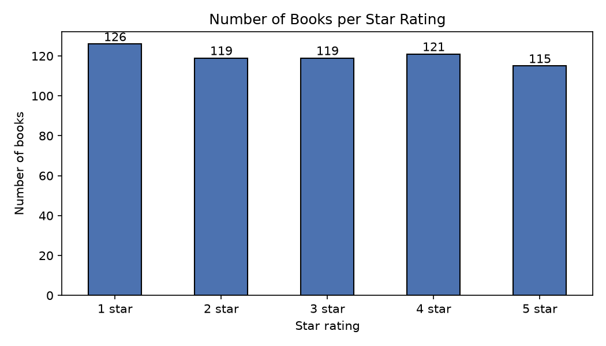

# Analysis Results (generated by scraper.py)

Dataset: **600 books** scraped from books.toscrape.com

## Mission 4 — Intelligence Analysis

**1. Most expensive book**
| Title | Price | Rating |
|---|---|---|
| The Barefoot Contessa Cookbook | £59.92 | 5 |

**2. Cheapest book**
| Title | Price | Rating |
|---|---|---|
| The Origin of Species | £10.01 | 4 |

**3. Average book price:** £35.29

**4. Books with a 5-star rating:** 115

**5. Percentage in stock:** 100.00%

**6. Top 5 highest-rated books** (ties on rating broken by lowest price)
| Title | Price | Rating |
|---|---|---|
| Greek Mythic History | £10.23 | 5 |
| The Power Greens Cookbook: 140 Delicious Superfood Recipes | £11.05 | 5 |
| Dear Mr. Knightley | £11.21 | 5 |
| Naturally Lean: 125 Nourishing Gluten-Free, Plant-Based Recipes--All Under 300 Calories | £11.38 | 5 |
| Old School (Diary of a Wimpy Kid #10) | £11.83 | 5 |

**7. Cheapest 5-star book**
| Title | Price | Rating |
|---|---|---|
| Greek Mythic History | £10.23 | 5 |

## Business Recommendation

I would prioritise the 5-star books that are priced at or below the median price (£36.95) and are in stock. Evidence 1: 115 of 600 scraped books (19.2%) are rated 5 stars, so customer-approved titles are plentiful, and 100.0% of the catalogue is in stock, so they can be sourced reliably. Evidence 2: 5-star books average £35.06 versus £35.29 for the whole catalogue, and 57 of them cost no more than the median, giving the best rating-per-pound for a new store.

## Final Challenge — CEO has £100

| Title | Price | Rating |
|---|---|---|
| Superman Vol. 1: Before Truth (Superman by Gene Luen Yang #1) | £11.89 | 5 |
| Old School (Diary of a Wimpy Kid #10) | £11.83 | 5 |
| Greek Mythic History | £10.23 | 5 |
| Dear Mr. Knightley | £11.21 | 5 |
| NaNo What Now? Finding your editing process, revising your NaNoWriMo book and building a writing career through publishing and beyond | £10.41 | 4 |
| History of Beauty | £10.29 | 4 |
| The Origin of Species | £10.01 | 4 |
| Naturally Lean: 125 Nourishing Gluten-Free, Plant-Based Recipes--All Under 300 Calories | £11.38 | 5 |
| The Power Greens Cookbook: 140 Delicious Superfood Recipes | £11.05 | 5 |

- **Number of books:** 9
- **Total cost:** £98.30
- **Total rating score:** 42

Method: exact 0/1 knapsack (dynamic programming) — each book bought once, maximising total stars with total cost ≤ £100 (cheapest basket chosen on ties).

## Bonus 3 — Books per star rating

| Rating | Books |
|---|---|
| 1 | 126 |
| 2 | 119 |
| 3 | 119 |
| 4 | 121 |
| 5 | 115 |

